<div align="center">


### ⚙️ One Lua script → a fully parametric pair of non-circular gears → STL → a working 3D-printed gearbox.


</div>

---

### 🎬 The printed gears in action

https://github.com/user-attachments/assets/737e5f75-4f76-44b6-9021-6abcec08a182

<sub>Two printed elliptical gears turning on their focus shafts. One gear speeds up while the other slows down, then they swap, all in one revolution. 🎵 Turn the sound on for the background music. Video not playing? [Download it](media/am-printed-gears.mp4).</sub>

---

## 📑 Contents

- [At a glance](#-at-a-glance)
- [The project journey](#-the-project-journey)
- [1 · Elevator pitch](#-1--elevator-pitch-1-minute-hand-drawn)
- [2 · The Lua script](#-2--the-lua-script)
- [3 · From script to print](#-3--from-script-to-print)
- [Where would you use it?](#-where-would-you-use-it)
- [Run it yourself](#-run-it-yourself)
- [Repository structure](#-repository-structure)
- [Team](#-team)

---

## 📌 At a glance

> Ordinary round gears give a **constant** speed ratio. **Elliptical gears** turning about one **focus** give a speed ratio that **changes smoothly through every revolution**. Machines use that to get a slow working stroke and a fast return.
>
> In the **Case Study "Cyber-Physical Production Systems using Additive Manufacturing"** at THD, our group wrote a **Lua script for IceSL** that builds a matching elliptical gear pair from a few design inputs. The teeth follow a **sine profile** wrapped around the ellipse. The script checks the design limits and exports the gears as **STL** for 3D printing. We then printed and assembled the gearbox.

| | |
|---|---|
| 🎯 **Product** | Elliptical gear set, axis in the focus point, sine tooth profile |
| 🧑‍💻 **Tool** | IceSL, the Lua-scripted modeler and slicer |
| 📐 **Inputs** | centre distance · ratio range i<sub>max</sub>/i<sub>min</sub> · face width · shaft bore · module **or** tooth count |
| 🖨️ **Output** | Two gear STLs, printed in white PLA on a printed base plate |

---

## 🗺️ The project journey

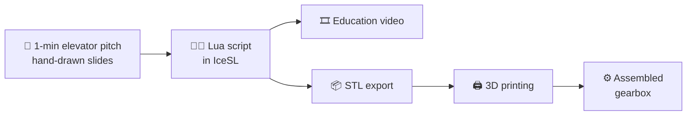

| Stage | What we did |
|---|---|
| 🎤 **Elevator pitch** | Sold our "product" in one minute with six hand-painted slides |
| 🧑‍💻 **Lua scripting** | Wrote a fully parametric gear generator for IceSL |
| 🎞️ **Education video** | Made an explainer video about our gear design for the course |
| 🖨️ **Print** | Exported the STLs, printed the gears and assembled them on a base plate |

---

## 🎤 1 · Elevator pitch (1 minute, hand-drawn)

No PowerPoint. We **painted every slide by hand** and told the story of a noisy factory that needs smoother, variable-speed motion.

<table>
<tr>
<td width="33%">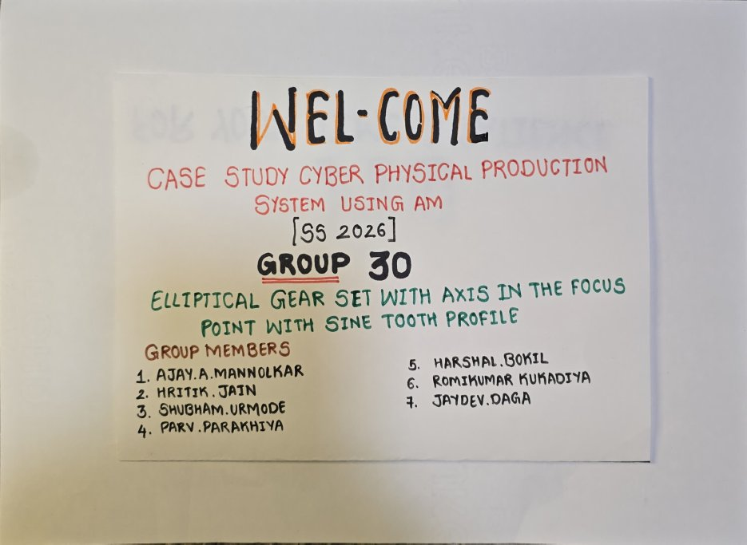</td>
<td width="33%">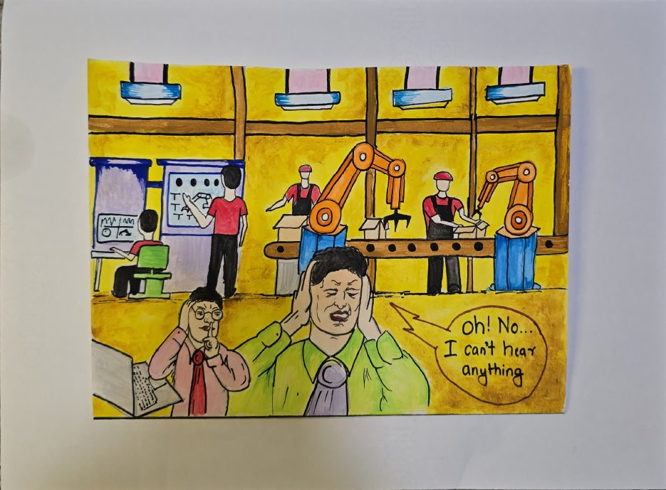</td>
<td width="33%">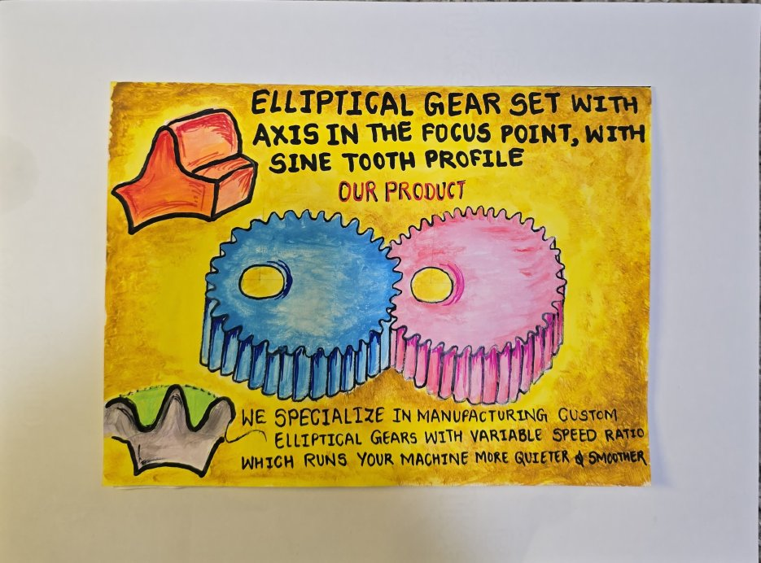</td>
</tr>
<tr>
<td align="center"><sub>① Welcome: Group 30</sub></td>
<td align="center"><sub>② The problem: "I can't hear anything!"</sub></td>
<td align="center"><sub>③ Our product</sub></td>
</tr>
<tr>
<td width="33%">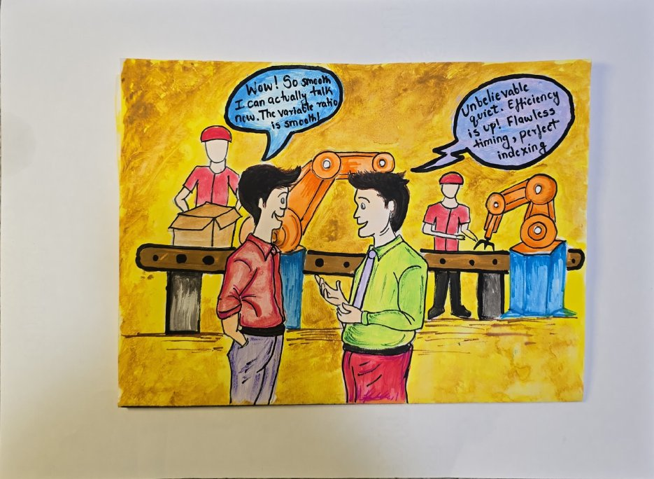</td>
<td width="33%">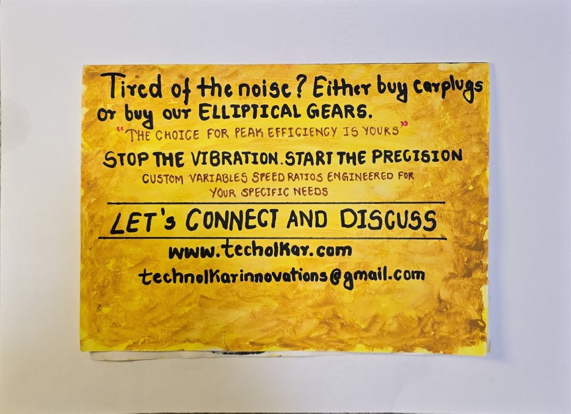</td>
<td width="33%">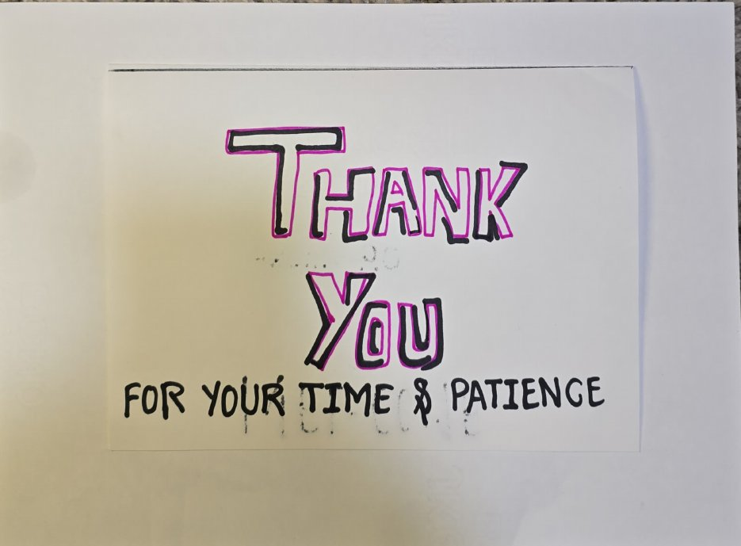</td>
</tr>
<tr>
<td align="center"><sub>④ After: smoother, quieter line</sub></td>
<td align="center"><sub>⑤ "Stop the vibration, start the precision"</sub></td>
<td align="center"><sub>⑥ Thank you</sub></td>
</tr>
</table>

📄 All slides as one PDF: [`docs/elevator-pitch-slides.pdf`](docs/elevator-pitch-slides.pdf)

---

## 🧑‍💻 2 · The Lua script

[`src/elliptical_gear_set.lua`](src/elliptical_gear_set.lua) runs in **IceSL**. Every input is a slider in IceSL's *Tweaks* panel, so the gears rebuild live as you change them:

<div align="center">
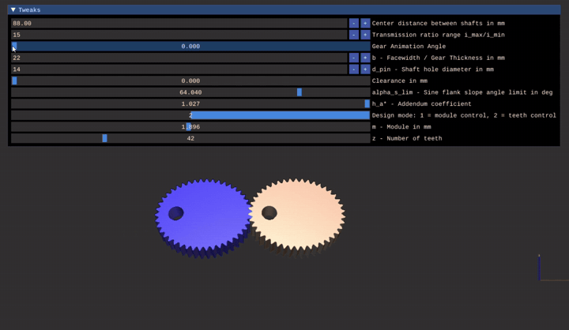
</div>

<details>
<summary><b>▶ Watch the full one-minute IceSL demo</b></summary>

<br/>

https://github.com/user-attachments/assets/4c1f1833-1003-4113-8b64-5b0a26206407

</details>

### How the script builds the gears

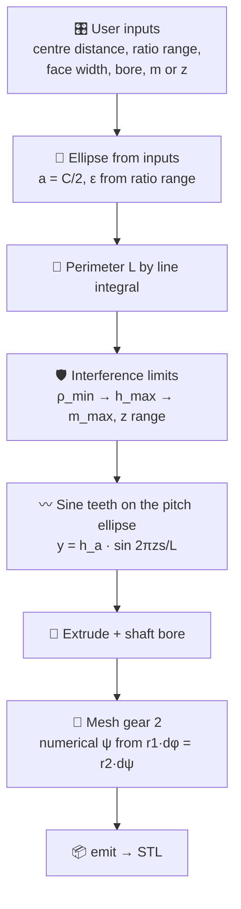

| Section | What it does |
|:---:|---|
| **1 · Inputs** | Centre distance, ratio range i<sub>max</sub>/i<sub>min</sub>, face width, shaft bore, clearance, flank-slope limit |
| **2 · Ellipse** | Eccentricity from the ratio range, ε = (√R − 1)/(√R + 1); polar curve about the focus; perimeter by line integral |
| **3 · Limits** | Minimum radius of curvature → maximum tooth height → module and tooth-count limits. **Two design modes:** set the module or set the number of teeth |
| **4 · Helpers** | Interpolation to space the teeth evenly along the arc length; numerical integration of the output angle of gear 2 |
| **5 · Tooth profile** | A sine wave with *z* periods wrapped along the ellipse normal, always pointing outward |
| **6 · Body** | `linear_extrude` of the profile minus the shaft hole |
| **7 · Meshing** | Phase shift for odd/even *z*; gear 2 placed and rotated to mesh with gear 1 |
| **8 · Stats** | Prints ε, ρ<sub>min</sub>, h<sub>max</sub>, m, z, α<sub>s</sub>, \|i\|<sub>max</sub> and \|i\|<sub>min</sub> |

<details>
<summary><b>🔍 The key ideas in code</b></summary>

```lua
-- Polar equation of the ellipse about its focus (the gear's shaft sits here)
local function r_p(phi)
    return a_e * (1 - epsilon_e * epsilon_e) / (1 - epsilon_e * math.cos(phi))
end

-- Sine tooth: y(s) = h_a * sin(2*pi*z*s/L)
-- Flank slope angle alpha_s = atan(2 * h_a*) keeps the teeth from getting too steep
local alpha_s_deg = math.deg(math.atan(2 * h_a_coeff))

-- Gear 2 meshes with gear 1 and its angle comes from equal pitch-line speed:
-- r1 * dphi = r2 * dpsi,  with  r1 + r2 = centre distance
local gear2 = translate(v(a, 0, 0)) * rotate(0, 0, -psi_2_deg) * gear2_shape
emit(gear1, 1)
emit(gear2, 2)
```

</details>

---

## 🖨️ 3 · From script to print

IceSL exported both gears as **STL**. We printed them and mounted them on their focus shafts on a printed base plate.

<table>
<tr>
<td width="57%">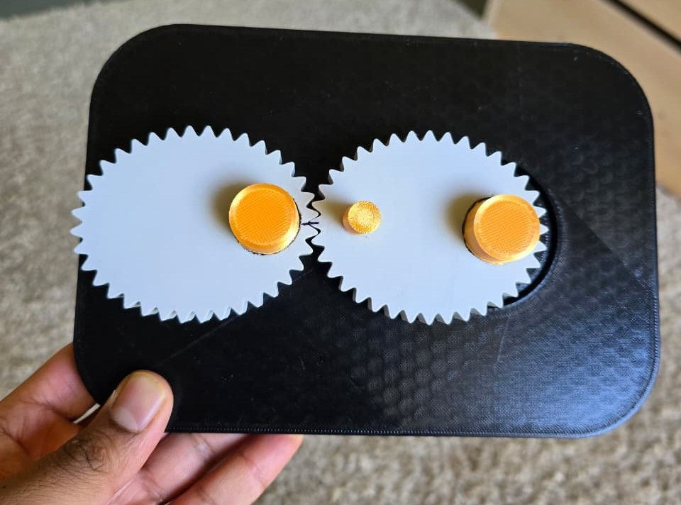</td>
<td width="43%">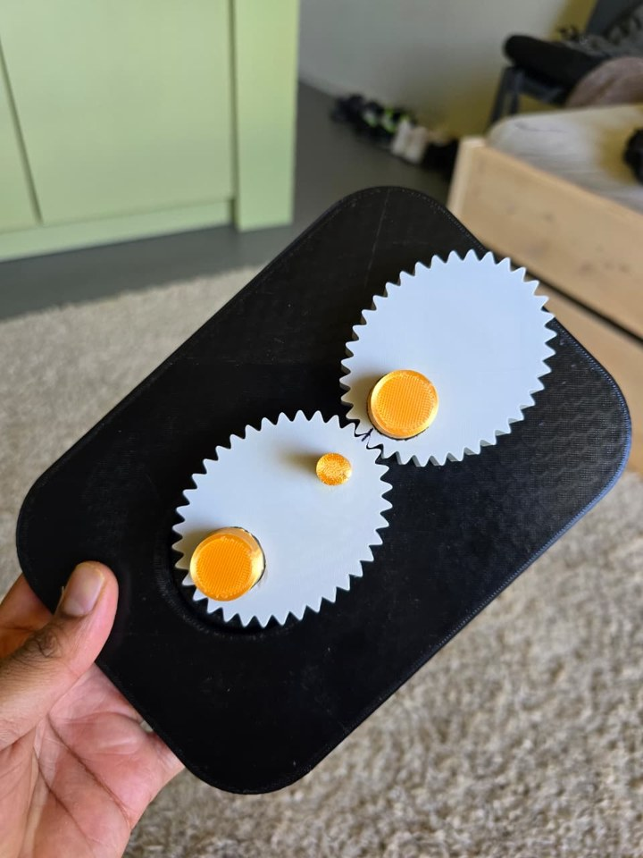</td>
</tr>
<tr>
<td align="center"><sub>Top view: shafts at the foci</sub></td>
<td align="center"><sub>Rotated: watch the contact point move</sub></td>
</tr>
</table>

<div align="center">
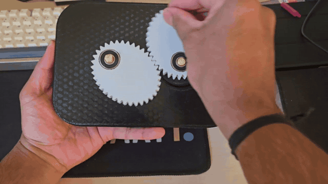
</div>

---

## 🏭 Where would you use it?

Our concept animation: an elliptical gear pair drives a **slider-crank**, so the stroke runs at a **changing speed** instead of a constant one.

<div align="center">
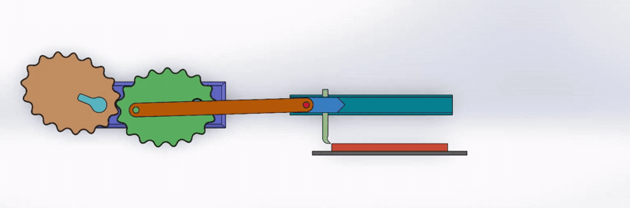
</div>

Typical uses for non-circular gears include **quick-return mechanisms**, packaging and printing machines, pumps and flow meters, and any place a machine needs to **slow down for the work and speed up for the return**.

---

## ▶️ Run it yourself

1. Install **[IceSL](https://icesl.loria.fr/)** (free)
2. Open [`src/elliptical_gear_set.lua`](src/elliptical_gear_set.lua) in the IceSL editor and **run** it
3. Change the sliders in the **Tweaks** panel: centre distance, ratio range, module or tooth count
4. Read the design statistics in the console. If something isn't possible, the script prints an `ERROR`
5. Export the gears as STL, or slice them straight in IceSL, and print

> 💡 Example from our demo: centre distance **88 mm**, ratio range **15**, face width **33 mm**, **42 teeth**, module **≈ 1.9 mm**

---

## 📁 Repository structure

```text
Elliptical-Gear-Set-IceSL-Lua/
├── src/
│   └── elliptical_gear_set.lua      # parametric IceSL script (the whole gear generator)
├── docs/
│   └── elevator-pitch-slides.pdf    # 6 hand-drawn pitch slides
├── media/                           # photos, GIFs and videos used in this README
└── README.md
```

---

## 👥 Team

**Group 30**, *Case Study: Cyber-Physical Production Systems using Additive Manufacturing* (SS 2026), Deggendorf Institute of Technology

Hritik Suresh Jain · **Ajay Arjun Mannolkar** · Shubham Dnyaneshwar Urmode · Parv Rajeshkumar Parakhiya · Harshal Bokil · Romikumar Rameshbhai Kukadiya · Jaydev Daga

---

## 🧠 What I learned

- 📐 **Non-circular gear geometry**: ellipse about a focus, variable transmission ratio, interference limits
- 🧑‍💻 **Code-driven CAD**: designing a mechanical part entirely in a Lua script with live parameters
- 🖨️ **Design for additive manufacturing**: from parametric model to STL to a working printed assembly
- 🎤 **Selling an idea in 60 seconds** with a hand-made elevator pitch

---

<div align="center">

### 👋 Built by **Ajay Arjun Mannolkar** and team
M.Sc. Mechatronics and Cyber-Physical Systems · THD Deggendorf

[](https://technolkar.github.io)
[](https://www.linkedin.com/in/ajaymannolkar)
[](https://www.youtube.com/@TechnolkarInnovations)

⭐ *If these gears made you smile, give the repo a star!*


</div>
